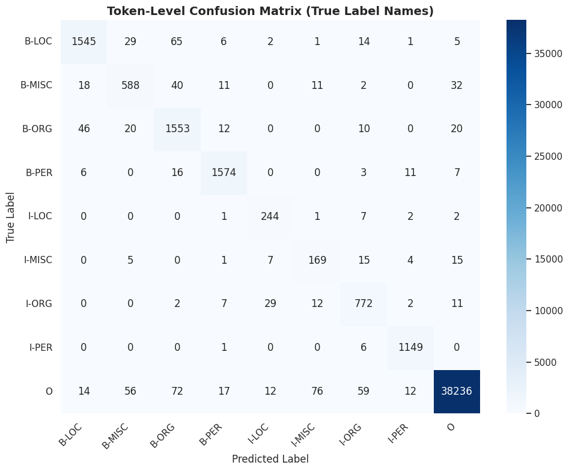
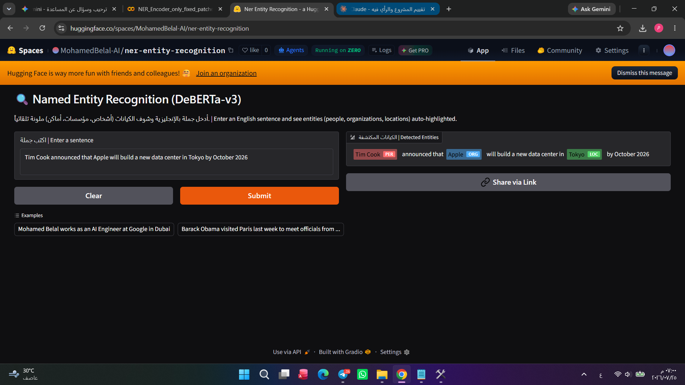

# 🏷️ Named Entity Recognition — DeBERTa-v3 Encoder-Only

### *Production-Grade NER Pipeline: Data Engineering → Training Stability → Entity-Level Evaluation → Deployment*
### *مشروع تعرف على الكيانات المسماة — من هندسة البيانات لاستقرار التدريب للتقييم الحقيقي للنشر*

<p align="center">
  
  
  
  
  
</p>

<p align="center">
  <a href="https://huggingface.co/spaces/MohamedBelal-AI/ner-entity-recognition"><b>🚀 Live Demo</b></a>
  ·
  <a href="#-evaluation--results--النتائج-والتقييم">📊 Evaluation</a>
  ·
  <a href="#-the-critical-bug-we-caught--الخطأ-الحرج-اللي-اتلقط">🐛 Critical Bug Fixed</a>
  ·
  <a href="#-deployment--النشر">🚀 Deployment</a>
</p>

---

## 📌 Overview | نظرة عامة

**English:**
A **Named Entity Recognition (NER)** system fine-tuned on the CoNLL-2003 dataset using `microsoft/deberta-v3-base` as an encoder-only token classifier. The project identifies four entity types — **Person (PER)**, **Organization (ORG)**, **Location (LOC)**, and **Miscellaneous (MISC)** — and is deployed as a live, interactive Gradio app.

**العربية:**
نظام **تعرف على الكيانات المسماة (NER)** بتم تدريبه على بيانات CoNLL-2003 باستخدام موديل `microsoft/deberta-v3-base` كمصنّف Token-level (Encoder-Only). المشروع بيحدد 4 أنواع كيانات — **أشخاص (PER)**، **مؤسسات (ORG)**، **أماكن (LOC)**، و**كيانات متنوعة (MISC)** — ومنشور فعلياً كتطبيق Gradio تفاعلي شغال Live.

---

## 🏗️ Pipeline Phases | مراحل الـ Pipeline

| المرحلة | Phase | الوصف المختصر |
|---|---|---|
| 1 | Data Engineering & Label Schema Lock | تحميل CoNLL، فحص المحاذاة، استخراج وتثبيت `label2id`/`id2label` في ملف JSON واحد لا يُعاد كتابته |
| 2 | Tag Distribution Analysis | فحص هيمنة كلاس `O`، توزيع الكيانات، Visualization |
| 3 | Tokenization & Sub-word Alignment | محاذاة الوسوم مع الـ Sub-words (`-100` masking) |
| 4 | Model Init & Stability Fixes | تحميل DeBERTa-v3 بـ `torch_dtype=float32` + `attn_implementation="eager"` لحل مشكلة NaN |
| 5 | Training with Warmup + Gradient Clipping | تدريب مستقر بـ Logging حقيقي و Checkpointing لكل Epoch |
| 6 | Entity-Level Evaluation (`seqeval`) | تقييم على مستوى الكيان الكامل مش الـ Token المنفرد |
| 7 | Deployment | حفظ + Consistency Assert + `requirements.txt` + اختبار استدلال + نشر على Hugging Face |

---

## 🐛 The Critical Bug We Caught | الخطأ الحرج اللي اتلقط

**English:** During review, an early version of this project had a **manually-guessed `id2label` mapping** hardcoded at the saving stage — reconstructed by eyeballing predictions on a single sentence instead of being pulled from the actual schema computed in Phase 1. Comparing it against the real sorted label list showed **5 out of 9 classes were mislabeled**. This was fixed by locking the schema once in `label_schema.json` and never re-deriving it, plus adding a hard `assert` gate before every save:

```python
assert deployed_id2label == original_id2label, "❌ Label mapping mismatch before saving!"
```

**العربية:** في نسخة مبكرة من المشروع، كان فيه `id2label` **متخمّن يدوياً** ومكتوب صريح وقت الحفظ — اتبني بناءً على قراءة نتيجة موديل على جملة واحدة بس، بدل ما يتسحب من المخطط الحقيقي المحسوب في المرحلة الأولى. لما قارناه بالترتيب الحقيقي، طلع **5 من أصل 9 كلاسات غلط**. اتصلحت المشكلة بتثبيت المخطط مرة واحدة في `label_schema.json` وعدم إعادة اشتقاقه أبداً، بالإضافة لإضافة فحص `assert` قاطع قبل أي عملية حفظ.

---

## ⚙️ Training Stability Fix | حل مشكلة استقرار التدريب

**English:** Training initially produced `NaN` loss from the very first batch. Root cause: DeBERTa-v3's disentangled attention mechanism is numerically unstable outside full FP32 precision, and `from_pretrained` was silently loading in a different precision. Fixed by forcing:
```python
model = AutoModelForTokenClassification.from_pretrained(
    MODEL_NAME, torch_dtype=torch.float32, attn_implementation="eager"
)
model = model.float()
```
Combined with a linear warmup scheduler and gradient clipping (`max_norm=1.0`) for full training stability.

**العربية:** التدريب طلّع Loss = NaN من أول Batch. السبب الجذري: آلية الـ Disentangled Attention بتاعة DeBERTa-v3 غير مستقرة رقمياً برّه دقة FP32 الكاملة، وكانت بتتحمّل بدقة مختلفة من غير ما ندري. اتصلحت بفرض `torch_dtype=torch.float32` و`attn_implementation="eager"` و`model.float()` صراحة، بالإضافة لـ Warmup Scheduler وGradient Clipping.

---

## 📊 Evaluation & Results | النتائج والتقييم

**English:** All metrics are computed with `seqeval` at the **entity (span) level** — not raw token accuracy, which would be inflated by the dominant `O` class.

**العربية:** كل المقاييس محسوبة بمكتبة `seqeval` على **مستوى الكيان الكامل** — مش Accuracy على مستوى التوكن المنفرد اللي كانت هتنتفخ بسبب هيمنة كلاس `O`.

### Overall Test Set Performance | الأداء العام على مجموعة الاختبار

| Metric | Value |
|---|---|
| Micro F1-Score | **91.29%** |
| Weighted F1-Score | **91.33%** |
| Gold Entity Spans Evaluated | 5,648 |

### Per-Entity Breakdown | التفصيل حسب نوع الكيان

| Entity Type | Precision | Recall | F1-Score |
|---|---|---|---|
| PER (Persons) | 96.20% | 97.09% | **96.65%** |
| LOC (Locations) | 93.85% | 92.39% | **93.11%** |
| ORG (Organizations) | 86.60% | 91.81% | **89.13%** |
| MISC (Miscellaneous) | 78.95% | 81.20% | **80.06%** |

### Confusion Matrix (Token-Level, True Label Names) | مصفوفة الالتباس بالأسماء الحقيقية

<p align="center">
  
</p>

**English:** The primary confusion source is structural ambiguity between `LOC` and `ORG` (65 LOC→ORG, 46 ORG→LOC misclassifications) — a known, natural overlap in real-world text (e.g. "Manchester" as a city vs. a football club name).

**العربية:** أكبر مصدر التباس هو التداخل الطبيعي بين `LOC` و`ORG` — تداخل معروف وطبيعي في النصوص الحقيقية (زي "مانشستر" كمدينة مقابل اسم نادي).

---

## 🚀 Deployment | النشر

**English:** Deployed as a live, interactive Gradio app on Hugging Face Spaces. The deployment pipeline enforces:
1. **Save Artifacts** — model + tokenizer + the *same* `label_schema.json` from Phase 1 (never re-written)
2. **Consistency Assert** — hard gate comparing the saved model's `config.id2label` against the original locked schema before declaring deployment-ready
3. **`requirements.txt`** — only real runtime dependencies (`transformers`, `torch`, `gradio`, `huggingface_hub`, `seqeval`, `spaces`)
4. **Inference Test on the saved artifact** — loaded strictly from disk (not the in-memory model) to simulate exactly what the Space runtime does

**العربية:** منشور كتطبيق Gradio تفاعلي شغال Live على Hugging Face Spaces. خط أنابيب النشر بيفرض:
1. **حفظ المخرجات** — الموديل + Tokenizer + *نفس* ملف `label_schema.json` من المرحلة الأولى (مش نسخة معاد كتابتها)
2. **فحص التطابق القاطع** — مقارنة برمجية بين `config.id2label` بتاع الموديل المحفوظ والمخطط الأصلي المقفول، قبل اعتبار النشر جاهز
3. **`requirements.txt`** — المكتبات المطلوبة فعلياً وقت التشغيل بس
4. **اختبار استدلال على النسخة المحفوظة فعلياً** — بتحميل من القرص مباشرة (مش من الذاكرة) لمحاكاة تامة لبيئة التشغيل الحقيقية

🔗 **[huggingface.co/spaces/MohamedBelal-AI/ner-entity-recognition](https://huggingface.co/spaces/MohamedBelal-AI/ner-entity-recognition)**

<p align="center">
  
</p>

---

## ⚙️ Tech Stack | الأدوات المستخدمة

| Category | Tools |
|---|---|
| Model | `microsoft/deberta-v3-base` (Encoder-Only Token Classification) |
| Training | `PyTorch`, `transformers`, linear warmup + gradient clipping |
| Evaluation | `seqeval` (entity-level Precision/Recall/F1), `scikit-learn` (confusion matrix) |
| Serving | `Gradio`, `spaces` (ZeroGPU decorator) |
| Deployment | Hugging Face Spaces |
| Data | CoNLL-2003 (Train/Valid/Test official splits) |

---

## 📁 Dataset | البيانات

**English:** [CoNLL-2003](https://www.clips.uantwerpen.be/conll2003/ner/) — 22,137 validated sentences across the official Train (~68%) / Validation (~16%) / Test (~16%) splits, covering 9 entity classes (`B-`/`I-` for PER, ORG, LOC, MISC, plus `O`).

**العربية:** بيانات [CoNLL-2003](https://www.clips.uantwerpen.be/conll2003/ner/) — 22,137 جملة تم التحقق منها موزعة على التقسيمات الرسمية (تدريب ~68% / تحقق ~16% / اختبار ~16%)، وتغطي 9 فئات وسوم.

---

## ⚙️ Installation | التشغيل

```bash
git clone https://huggingface.co/spaces/MohamedBelal-AI/ner-entity-recognition
cd ner-entity-recognition
pip install -r requirements.txt
python app.py
```

---

## 👤 Author | المطور

**Eng. Mohamed Belal**
Data Science & AI Diploma — Delta Technological University

---

## 📜 License | الترخيص

This project is released under the MIT License.
هذا المشروع منشور تحت رخصة MIT.
