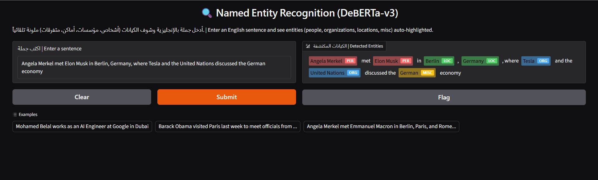
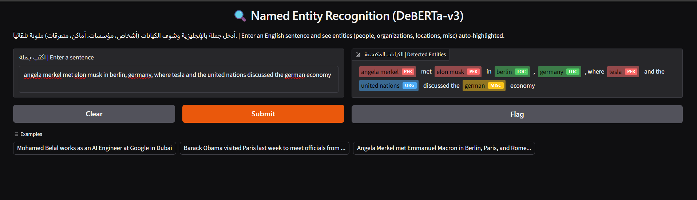

# Named Entity Recognition with DeBERTa-v3 on CoNLL-2003 | التعرف على الكيانات المسماة

[English](#english) | [العربية](#arabic)

<a id="english"></a>

## English
I fine-tuned `microsoft/deberta-v3-base` to find people, organizations, locations and miscellaneous names in English text. This repo has the full notebook (data preparation, training, evaluation, packaging) and a small Gradio demo. The trained model is on the Hugging Face Hub: [MohamedBelal-AI/deberta-v3-base-conll2003-ner](https://huggingface.co/MohamedBelal-AI/deberta-v3-base-conll2003-ner).

### Results

Scores are entity-level, computed with `seqeval`: an entity counts as correct only if both its boundaries and its type match. The test set is the official CoNLL-2003 test split (3,453 sentences, 5,648 entities).

- Test F1: **92.48** (precision 91.58, recall 93.40)
- Validation F1 on the official dev split, best epoch: 96.21
- Test F1 with every word lowercased: **88.75** (a drop of 3.73 points)

Test F1 per entity type:

- PER: 97.58 (precision 97.88, recall 97.28, 1,617 entities)
- LOC: 93.90 (precision 93.73, recall 94.06, 1,668 entities)
- ORG: 91.01 (precision 89.15, recall 92.96, 1,661 entities)
- MISC: 81.30 (precision 78.85, recall 83.90, 702 entities)

The gap between dev and test is expected, since the CoNLL test split is known to be harder than the dev split. I trained once with seed 42 and did not try other backbones or seeds, so differences of a few tenths of a point between runs should not be read as meaningful.

### Demo

The sentence below has seven entities. In normal casing the model gets all seven right:

> Angela Merkel met Elon Musk in Berlin, Germany, where Tesla and the United Nations discussed the German economy.



The same sentence in lowercase gets six of seven right. `tesla` is tagged as a person instead of an organization:



There is no hosted demo at the moment. You can run it locally (see below).

### How it works

1. **Data.** The three official splits are read and validated. The `-DOCSTART-` lines are removed because they are document markers, not sentences.
2. **Tokenization.** DeBERTa-v3 splits words into sub-words. The label goes to the first sub-word of each word and the rest are masked with `-100`. A check confirms that no sentence is truncated at 256 sub-words.
3. **Training.** AdamW with learning rate 2e-5, weight decay 0.01, batch size 16, 10% warmup followed by linear decay, and gradient clipping at 1.0. In 20% of the training sentences every word is lowercased, so the model does not rely only on capital letters. The best epoch is chosen by validation F1 (early stopping with patience 2; in the end all 5 epochs ran). One epoch takes about 4 minutes on a Colab T4.
4. **Evaluation.** The test set is used once, at the end: normal copy, lowercased copy, confusion matrix and a read-through of real errors.
5. **Demo.** `app.py` splits text the way CoNLL does (punctuation separated from words), so a comma never ends up inside a highlighted entity.


One thing that cost me time: in my Colab runtime the model loaded in float16 by default, and AdamW then produced NaN right after the first update. Loading with `dtype=torch.float32` fixed it, and the notebook now asserts it before training.

### Error analysis

I read the first sentences with errors in the test file. This is file order, not a random sample, so it says nothing about proportions.

- Some errors are disagreements with the annotation rather than model mistakes. `CHINA` in a sports headline is labeled as a person. Pontypridd and Leicester, which are rugby clubs, are labeled as locations while the model says organization.
- Some errors are real. `Germon`, a cricketer, is predicted as an organization, and ALL-CAPS headlines are hard for the model.
- In the token-level confusion matrix, most mistakes are between ORG, LOC and MISC. The model also over-labels MISC: about 130 plain tokens were tagged as MISC.

### Limitations

- English only. The data is Reuters newswire from the 1990s, so modern or domain-specific text (tech, social media) may do worse.
- Casing matters. Lowercase input costs 3.73 F1 points on the test set, and ORG is the type that suffers most (91.01 down to 85.12).
- MISC is a catch-all category and the weakest type. City names used for sports teams make ORG and LOC hard to separate.
- Input longer than 256 sub-word tokens is truncated.
- CoNLL has some annotation noise, which puts a ceiling on how high the score can go.

### Run it

Demo:

```bash
pip install -r requirements.txt gradio
python app.py
```

The first start downloads the model (about 740 MB) from the Hub.

Use it from Python:

```python
from app import predict_entities

result = predict_entities("Barack Obama visited Paris last week to meet officials from the United Nations")
print([(result["text"][e["start"]:e["end"]], e["entity"]) for e in result["entities"]])
```

Retrain: open `ner-entity-recognition-v2.ipynb` in Colab and set the paths in the config cell. The CoNLL-2003 files are not included. The notebook expects `train.txt`, `valid.txt` and `test.txt` inside a zip on Google Drive. The upload cells need an `HF_TOKEN` secret and your own repo names.

### Changes since v1

v1 scored 91.29 test F1 and v2 scores 92.48, on the same test split. What changed: the official dev split is now used for model selection (v1 held out 10% of train instead), `-DOCSTART-` is removed, the learning rate is lower with warmup and clipping, the training data includes lowercased sentences, and the demo tokenizes punctuation properly. I changed several things at once, so I cannot say which one gave the gain.

### Files

```
ner-entity-recognition-v2.ipynb   full pipeline
app.py                            Gradio demo, loads the model from the Hub
requirements.txt                  pinned versions
assets/                           screenshots and training curves
README.md                         this file, in English and Arabic
```

### License and author

MIT. Built by Mohamed Belal.

---

<a id="arabic"></a>

<div dir="rtl">

## العربية
ضبطتُ نموذج `microsoft/deberta-v3-base` ليستخرج أسماء الأشخاص والمؤسسات والأماكن والأسماء المتفرقة من النصوص الإنجليزية. يحتوي المستودع على الـ notebook الكامل (تجهيز البيانات والتدريب والتقييم وتجهيز النموذج للنشر) وتطبيق Gradio صغير للتجربة. النموذج المدرَّب منشور على Hugging Face: [MohamedBelal-AI/deberta-v3-base-conll2003-ner](https://huggingface.co/MohamedBelal-AI/deberta-v3-base-conll2003-ner).

### النتائج

النتائج على مستوى الكيان وحُسبت بمكتبة `seqeval`: لا يُحسب الكيان صحيحاً إلا إذا طابقت حدوده ونوعه معاً. مجموعة الاختبار هي تقسيم الاختبار الرسمي لـ CoNLL-2003 (3,453 جملة و5,648 كياناً).

- F1 على الاختبار: **92.48** (الدقة 91.58 والاستدعاء 93.40)
- F1 على مجموعة التحقق الرسمية في أفضل epoch: 96.21
- F1 على الاختبار بعد تحويل كل الكلمات إلى حروف صغيرة: **88.75** (انخفاض 3.73 نقطة)

F1 على الاختبار لكل نوع:

- PER: 97.58 (الدقة 97.88 والاستدعاء 97.28، و1,617 كياناً)
- LOC: 93.90 (الدقة 93.73 والاستدعاء 94.06، و1,668 كياناً)
- ORG: 91.01 (الدقة 89.15 والاستدعاء 92.96، و1,661 كياناً)
- MISC: 81.30 (الدقة 78.85 والاستدعاء 83.90، و702 كياناً)

الفرق بين نتيجة التحقق ونتيجة الاختبار متوقع، فمعروف أن اختبار CoNLL أصعب من مجموعة التحقق. درّبتُ مرة واحدة ببذرة 42 ولم أجرّب نماذج أساسية أخرى ولا بذوراً أخرى، لذلك لا ينبغي اعتبار فروق بضعة أعشار من النقطة بين تشغيل وآخر فروقاً حقيقية.

### التجربة

الجملة التالية فيها سبعة كيانات. بالحروف العادية أصاب النموذج السبعة كلها:

> Angela Merkel met Elon Musk in Berlin, Germany, where Tesla and the United Nations discussed the German economy.


والجملة نفسها بالحروف الصغيرة أصاب منها ستة من سبعة. صنّف `tesla` كشخص بدل مؤسسة:


لا توجد نسخة مستضافة للتجربة حالياً. يمكنك تشغيلها على جهازك (الشرح أدناه).

### كيف يعمل

1. **البيانات.** تُقرأ التقسيمات الرسمية الثلاثة وتُفحص. وتُحذف أسطر `-DOCSTART-` لأنها علامات بداية مستندات وليست جملاً.
2. **التقطيع.** يقسّم DeBERTa-v3 الكلمات إلى أجزاء فرعية. يُعطى الوسم لأول جزء من كل كلمة وتُخفى بقية الأجزاء بالقيمة `-100`. ويتأكد فحص من أن أي جملة لا تُقص عند 256 جزءاً.
3. **التدريب.** المحسّن AdamW بمعدل تعلم 2e-5 وweight decay بقيمة 0.01 وحجم دفعة 16، مع إحماء بنسبة 10% ثم تناقص خطي، وقص للجراديانت عند 1.0. وفي 20% من جمل التدريب تُحوَّل كل الكلمات إلى حروف صغيرة حتى لا يعتمد النموذج على الحرف الكبير وحده. يُختار أفضل epoch حسب F1 على التحقق (إيقاف مبكر بصبر 2، ومع ذلك اكتملت الـ 5 epochs). يستغرق الـ epoch الواحد نحو 4 دقائق على Colab T4.
4. **التقييم.** تُستخدم مجموعة الاختبار مرة واحدة في النهاية: النسخة العادية والنسخة بالحروف الصغيرة، ومصفوفة الإرباك، وقراءة أخطاء حقيقية.
5. **التطبيق.** يقطّع `app.py` النص كما يفعل CoNLL (علامات الترقيم منفصلة عن الكلمات)، فلا تدخل الفاصلة في الكيان المظلَّل.


شيء أخذ مني وقتاً: في بيئة Colab عندي حُمّل النموذج بدقة float16 افتراضياً، فأنتج AdamW قيمة NaN بعد أول تحديث مباشرة. وحلّ المشكلة تحميله بـ `dtype=torch.float32`، والـ notebook يتحقق من ذلك قبل التدريب.

### تحليل الأخطاء

قرأتُ أول الجمل التي فيها أخطاء في ملف الاختبار. هذا بترتيب الملف وليس عينة عشوائية، فلا يصلح للحكم على النسب.

- بعض الأخطاء خلاف مع الوسم الأصلي وليست أخطاء من النموذج. كلمة `CHINA` في عنوان رياضي موسومة كشخص. وPontypridd وLeicester، وهما ناديان للرجبي، موسومان كأماكن بينما قال النموذج مؤسسة.
- وبعضها أخطاء حقيقية. `Germon`، وهو لاعب كريكيت، توقّعه النموذج مؤسسة، والعناوين المكتوبة بحروف كبيرة كلها صعبة عليه.
- في مصفوفة الإرباك على مستوى التوكن، أغلب الأخطاء بين ORG وLOC وMISC. كما أن النموذج يبالغ في وسم MISC: نحو 130 توكن عادياً وُسمت MISC.

### القيود

- الإنجليزية فقط. البيانات أخبار Reuters من التسعينيات، فقد يكون الأداء أضعف على النصوص الحديثة أو المتخصصة (التقنية ووسائل التواصل).
- حالة الأحرف مهمة. الإدخال بحروف صغيرة يخسّر 3.73 نقطة F1 على الاختبار، والنوع الأكثر تأثراً هو ORG (من 91.01 إلى 85.12).
- MISC فئة عامة وهي أضعف الأنواع. وأسماء المدن المستخدمة لأسماء الفرق الرياضية تصعّب التفريق بين ORG وLOC.
- أي مدخل أطول من 256 جزءاً فرعياً يُقص.
- في CoNLL بعض الأخطاء في الوسوم، وهذا يضع سقفاً لأعلى نتيجة ممكنة.

### التشغيل

التطبيق:

```bash
pip install -r requirements.txt gradio
python app.py
```

أول تشغيل ينزّل النموذج (نحو 740 MB) من الـ Hub.

الاستخدام من بايثون:

```python
from app import predict_entities

result = predict_entities("Barack Obama visited Paris last week to meet officials from the United Nations")
print([(result["text"][e["start"]:e["end"]], e["entity"]) for e in result["entities"]])
```

إعادة التدريب: افتح `ner-entity-recognition-v2.ipynb` في Colab واضبط المسارات في خلية الإعدادات. ملفات CoNLL-2003 غير مرفقة. يتوقع الـ notebook وجود `train.txt` و`valid.txt` و`test.txt` داخل ملف zip على Google Drive. وخلايا الرفع تحتاج سراً باسم `HF_TOKEN` وأسماء المستودعات الخاصة بك.

### ما تغيّر منذ النسخة الأولى

حققت النسخة الأولى F1 بقيمة 91.29 على الاختبار، وتحقق النسخة الثانية 92.48 على تقسيم الاختبار نفسه. التغييرات: صارت مجموعة التحقق الرسمية هي المستخدمة لاختيار النموذج (كانت الأولى تقتطع 10% من بيانات التدريب)، وحُذف `-DOCSTART-`، وانخفض معدل التعلم مع إحماء وقص للجراديانت، وأُضيفت جمل بحروف صغيرة لبيانات التدريب، وصار التطبيق يقطّع علامات الترقيم بشكل صحيح. غيّرتُ عدة أشياء معاً، فلا أستطيع القول أيّها صنع الفرق.

### الملفات

```
ner-entity-recognition-v2.ipynb   المسار الكامل
app.py                            تطبيق Gradio، يحمّل النموذج من الـ Hub
requirements.txt                  إصدارات ثابتة
assets/                           لقطات الشاشة ومنحنيات التدريب
README.md                         هذا الملف، بالإنجليزية والعربية
```

### الرخصة والمؤلف

MIT. من إعداد محمد بلال.

</div>
